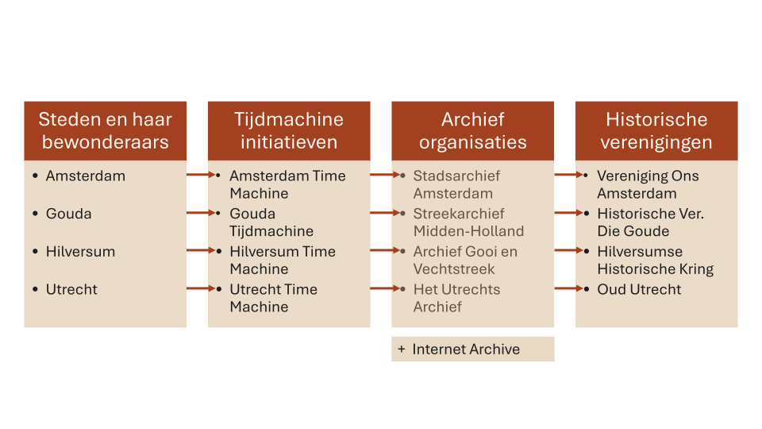
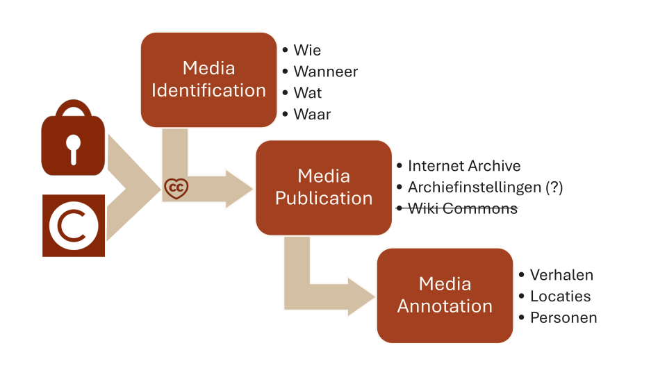
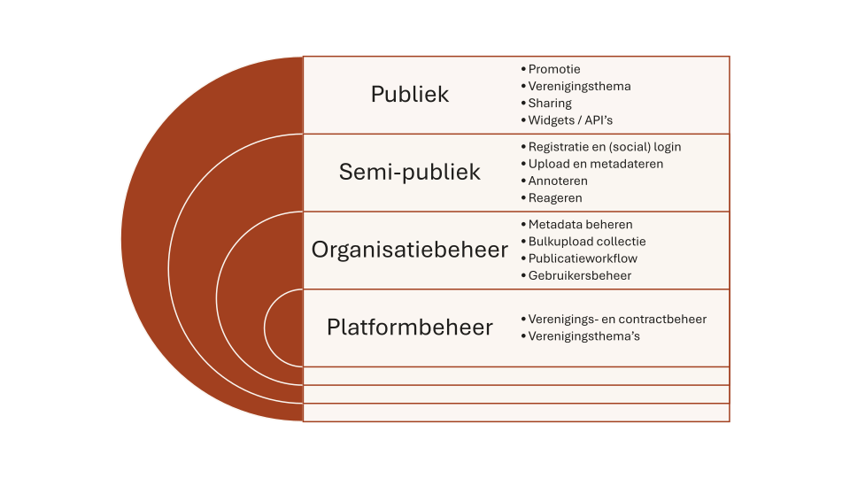
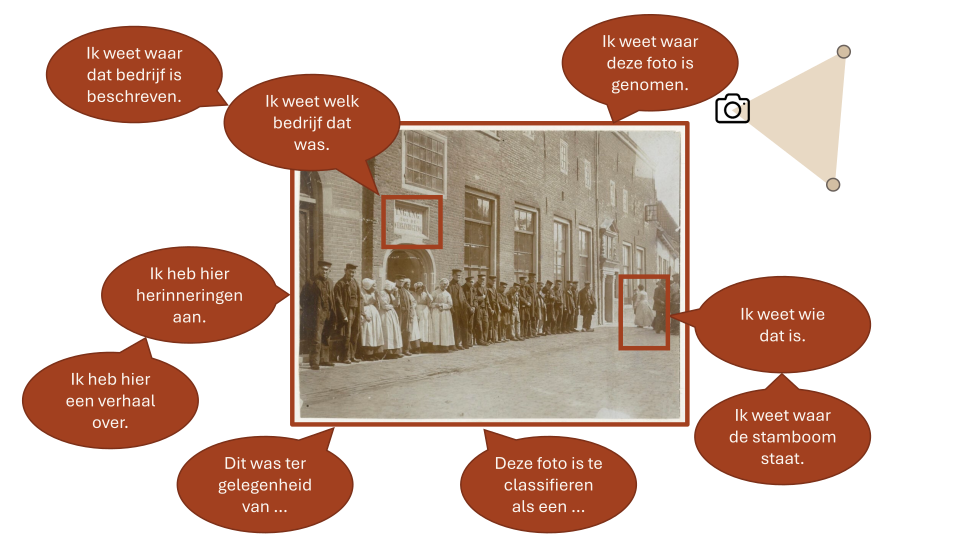
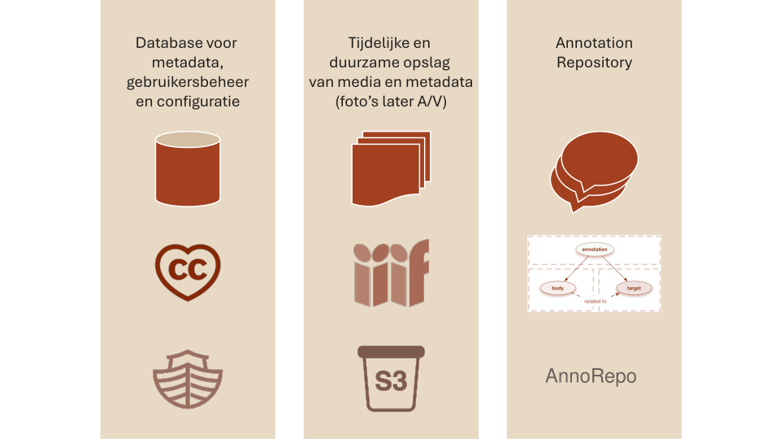

# Praatplaten # {#praatplaten}

Deze praatplaten komen uit de verkenning van augustus 2026 en dienden als gespreksstof met de
partners. Waar ze opslag bij het Internet Archive of een persistente identifier (PID) als vaste
stap tonen, geldt inmiddels het [[#keuze-oplossingsrichting]]: dat is een latere fase, en de
pilot slaat alles in eigen beheer op binnen de EER.

<h3 id="praatplaat-stakeholders">Belanghebbenden</h3>

Per stad werken vier soorten partijen samen: de stad en haar bewonderaars, het lokale
tijdmachine-initiatief, het archief en de historische vereniging.

<h3 id="praatplaat-media-process">Mediaproces</h3>

Een bijdrage wordt eerst geïdentificeerd (wie, wanneer, wat, waar), daarna gepubliceerd en
vervolgens verrijkt met verhalen, locaties en personen. Privacy en auteursrecht gaan aan
publicatie vooraf; Wikimedia Commons viel al in de verkenning af als publicatieplek.

<h3 id="praatplaat-process-steps">Processtappen</h3>

Van upload tot hergebruik groeit een bijdrage in vijf stappen: van ruwe media met metadata
tot gecontroleerd en verrijkt materiaal dat tijdmachines, verenigingen en archieven
kunnen gebruiken.

<h3 id="praatplaat-platform-parts"> Platformonderdelen</h3>

Het platform is opgebouwd in schillen: wat iedereen ziet, wat ingelogde deelnemers doen, wat
een organisatie beheert en wat de platformbeheerder regelt.

<h3 id="praatplaat-annotations">Annotaties</h3>

Eén foto roept veel soorten kennis op: wie of wat erop staat, waar en wanneer hij is
gemaakt, waar meer informatie te vinden is, en persoonlijke herinneringen. Elk daarvan is een
verrijking in het hoofdstuk [[#verrijkingen]].

<h3 id="praatplaat-technology-parts">Technische onderdelen</h3>

De techniek valt uiteen in drie delen: een database voor metadata en gebruikers, opslag van de
media met IIIF, en een annotatieserver (AnnoRepo) voor de W3C Web Annotations.
