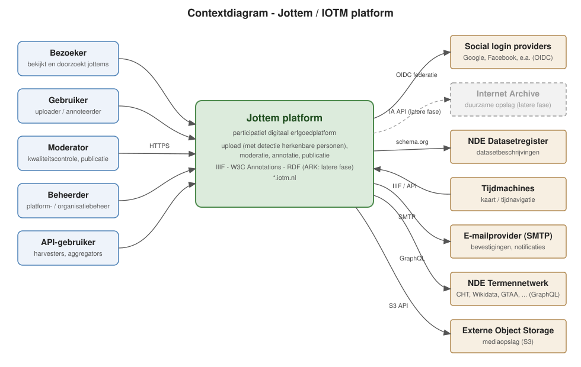

# Systeemarchitectuur # {#systeemarchitectuur}

De [systeemarchitectuur](systeemarchitectuur/architectuur.html) van Jottem beschrijft een op Docker gebaseerde systeemarchitectuur voor het Jottem-platform: een participatief digitaal erfgoedplatform waarin gebruikers media (jottems) uploaden, moderatoren deze beoordelen en publiceren, en annoteerders verrijkingen toevoegen. Het geheel wordt via subdomeinen onder iotm.nl ontsloten en implementeert de in het designdocument genoemde standaarden: IIIF Image API 3.0, IIIF Presentation API 3.0, IIIF Change Discovery, W3C Web Annotations, schema.org AP NDE en RSS (ARK volgt in een latere fase, zie [[#keuze-open-vragen]]).

*(klik op bovenstaand contextdiagram voor het gehele architectuurdocument)*

De weg van een bijdrage door het platform, in het kort:

1. Een gebruiker logt in via Authentik en opent het uploadformulier vanuit een project.
2. De foto gaat via een tijdelijke link rechtstreeks naar de objectopslag (S3); een
    beeldbank-permalink wordt alleen verwezen.
3. De Herkenbaar API controleert de foto op herkenbare personen; zo nodig volgt de
    toestemmingsvraag.
4. De backend-API (FastAPI) legt de jottem vast in PostgreSQL met status "nieuw" en schrijft een
    regel in het Gebeurtenislog.
5. Een moderator keurt goed of af; bij goedkeuring maakt de worker het IIIF-derivaat en gaat de
    goedkeuringsmail via de outbox.
6. De jottem is te zien op de webapplicatie (Next.js) via Cantaloupe (IIIF Image) en Varnish, en
    verschijnt in de open data: IIIF-manifest, RSS, RDF en de datadump.
7. Annotaties gaan via de backend-API naar AnnoRepo; elke wijziging komt in het Gebeurtenislog,
    waarna de worker de RDF van het project bijwerkt.
